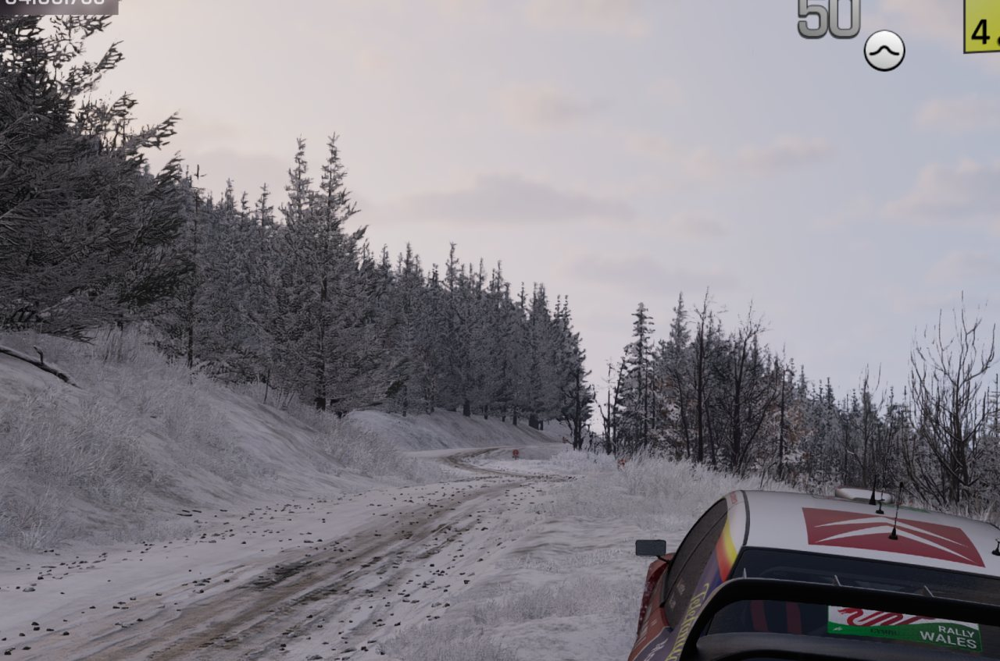
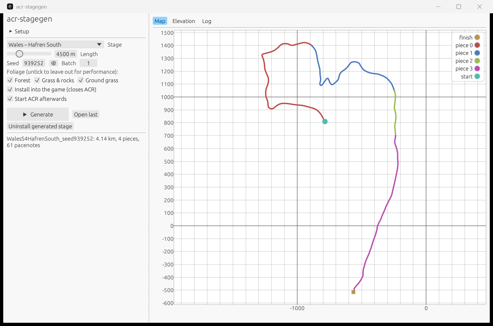
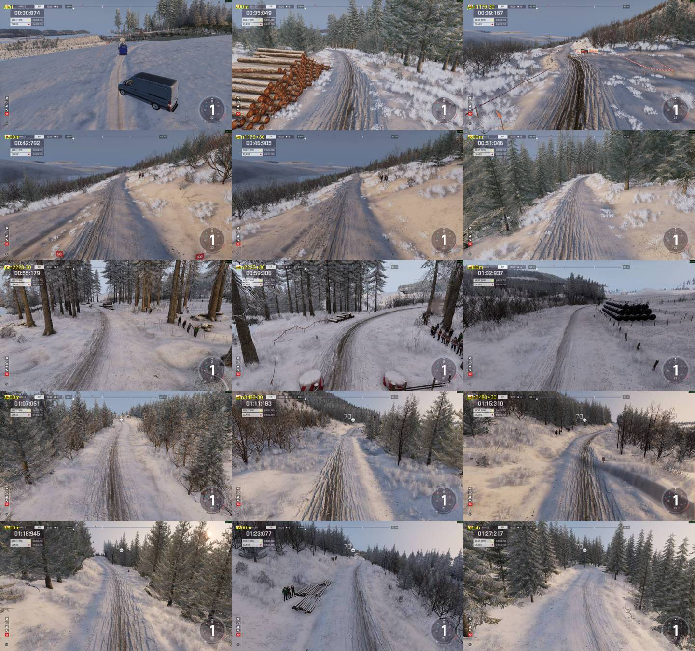

# acr-stagegen

**New rally stages for Assetto Corsa Rally, generated from the stages you already own.**

acr-stagegen cuts the official stages into pieces and stitches them together in a
new order: new corners, new sequences, new pacenotes. Every seed is a different
stage. Everything comes from your own game install; nothing is downloaded.



> **Unofficial fan project.** Not affiliated with, endorsed by or supported by
> Kunos Simulazioni, Supernova Games Studios or the publisher of Assetto Corsa
> Rally. "Assetto Corsa" is a trademark of its owner. acr-stagegen contains no
> game files: stages are generated on your PC from your own copy of the game.
> Use it offline and at your own risk; it may stop working after game updates.

> **Status: early, good enough for practice.**
> Wales – Hafren South works well. The other stages are marked
> *experimental*: they may be undrivable or crash the game for now.

---

## Quick start

1. **Download** `acr-stagegen.exe` from the
   [latest nightly release](../../releases/tag/nightly). It is a single file;
   there's nothing to install.
2. **Start it.** Windows may show a blue "Windows protected your PC" box
   because the program is not signed: click *More info* → *Run anyway*.
3. The program **finds Assetto Corsa Rally by itself** (through Steam). If it
   doesn't, open *Setup* and paste the game folder, e.g.
   `D:\SteamLibrary\steamapps\common\Assetto Corsa Rally`.
4. Pick a **stage**, a **length** and a **seed** (any number, or the 🎲 button),
   then press **▶ Generate**. A build takes about a minute; the bar shows what
   it's doing.
5. With *Install into the game* ticked, the new stage is installed automatically
   (ACR is closed first if it's running). Tick *Start ACR afterwards* to jump
   straight in.



## Driving your stage

The generated stage **takes the place of the stage it was made from** (for
now). For Hafren South:

*Free Practice* → **Wales** → **Hafren South** → start the session.

You'll see the original stage name and length in the menu, but you'll drive the
new layout, with matching pacenotes.

To get the original stage back, press **Uninstall generated stage**.

## The options

| Option | What it does |
|---|---|
| **Stage** | Which official stage to take the pieces from. |
| **Length** | The length you'd like. Each source stage only has so much road, so the program picks the closest length that's possible. |
| **Seed** | The "recipe" number. Same stage + length + seed = the same result, so you can share good ones with friends. |
| **Batch** | Builds several stages in a row (seed, seed+1, …), so you can compare them on the map. Only the last one is installed. |
| **Forest / Grass & rocks / Ground grass** | Trees and plants along the road. Untick some if your PC struggles; the stage then looks barer but runs faster. |
| **Install / Start ACR** | Put the stage into the game automatically, and optionally start the game. |

The **Map** tab shows the new route from above (each colour is one piece of an
original stage), **Elevation** shows the height profile with the joins marked,
and **Log** shows the details of the last build.

## What a stage looks like

A camera tour through a generated stage, from the start (top left) to the finish:



## Good to know

- **It's a mod:** it adds three files to `Assetto Corsa Rally\acr\Content\Paks\~mods`.
  *Uninstall generated stage* removes them. Your original game files are never
  changed.
- **Online / leaderboards:** play generated stages offline and don't submit
  times from them. While a generated stage is installed it uses the original
  stage's slot, so uninstall it before playing online.
- **Game updates** may break it until acr-stagegen is updated.
- Known rough edges: the service park can look odd, small seams at the joins,
  and a few distant hills may look out of place.

---

## For developers

The GUI (`gui/`, Rust + [egui](https://github.com/emilk/egui)) runs the
generator backend (`stagegen/`, Python), which is embedded as a frozen exe in
release builds. Base-game files are Oodle-compressed; `oodle_shim/` provides an
open-source decompressor DLL (via
[oozextract](https://crates.io/crates/oozextract), MIT) so no proprietary Oodle
DLL is needed.

```
pip install -r requirements.txt                 # numpy, scipy (+ matplotlib for PNG previews)
python -m stagegen.cli list                     # levels in the install
python -m stagegen.cli build --level WalesS4HafrenSouth --length 4500 --seed 1 --out out --install
python -m stagegen.cli build ... --no-forest --no-grass --no-foliage   # leave foliage out
python -m stagegen.cli build ... --cfg seam_width=40                    # any WPConfig option
python -m stagegen.cli uninstall
```

Release build (what `.github/workflows/nightly.yml` does):

```
cargo build --release --manifest-path oodle_shim/Cargo.toml
python -m PyInstaller packaging/backend.spec --distpath packaging/dist --workpath packaging/build
cargo build --release --manifest-path gui/Cargo.toml      # embeds packaging/dist/stagegen-backend.exe
```

In-game test automation (`tools/`): `acr_autotest.py` installs a build, starts
ACR, drives the menus with a virtual gamepad (ViGEmBus + vgamepad), drives off
the start line, then runs a camera tour via a UE4SS Lua mod and saves a contact
sheet, all hands-off.

### How a stage is built (`stagegen/build/wp.py`)

1. **Layout** (`tiles.py`): the source route is cut where it crosses the 350 m
   track-tile grid; pieces are joined grid line to grid line, so road and
   terrain meet edge to edge.
2. **Level**: tile actors, props, decals, crowds etc. move with their piece's
   rigid transform to a free area next to the original map; route splines,
   start/finish and splits are rebuilt; the RVT volume follows.
3. **Terrain**: each piece keeps the terrain it owns (Voronoi on the new
   layout); neighbouring pieces' terrain is blended at the seams; the coarse
   backdrop terrain is reshaped into filler ground under the whole stage.
4. **Foliage**: PCG forest and ground cover (HISM/ISM instances) are moved per
   instance; their cluster trees and cached bounds are rebuilt.
5. **Collision** (`DA_*BakedData`), **pacenotes** (forward/reverse tables) and an
   uncompressed IoStore container (`pakchunk99-<Level>_Stagegen_9_P`) that
   overrides only the rewritten packages.

### Reverse-engineered formats (`stagegen/extract/`, `stagegen/build/`)
- `iostore.py` IoStore TOC v8 reader; `zen.py` zen package header (5.5+ summary
  with cell maps); `unversioned.py` unversioned property headers (zero masks!).
- `bakeddata.py` / `writers.py` dmphysics BakedDataContainer (4 fields; meshes in
  metres, axes x,up,y), byte-identical round trip.
- `splines.py` DMSplineComponent curves; `pacenote_table.py` pacenote rows.
- `mesh_clip.py` / `hlod.py` cooked static mesh LODs; `foliage.py` (H)ISM
  instances, cluster trees, FBox / box-sphere bounds.
- `wp_hash.py` World Partition runtime spatial hash; `build/cityhash.py` CityHash64.
